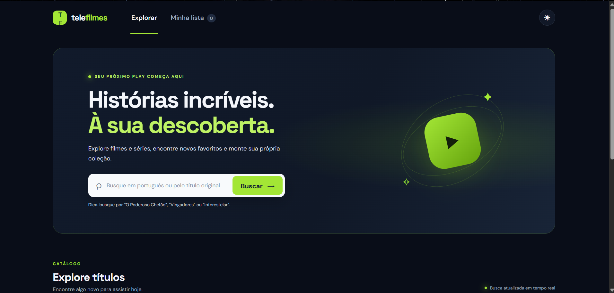
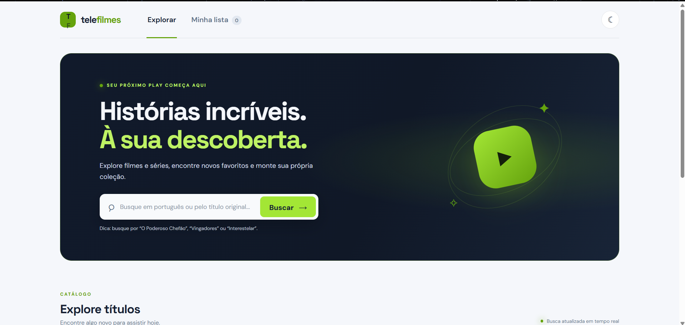
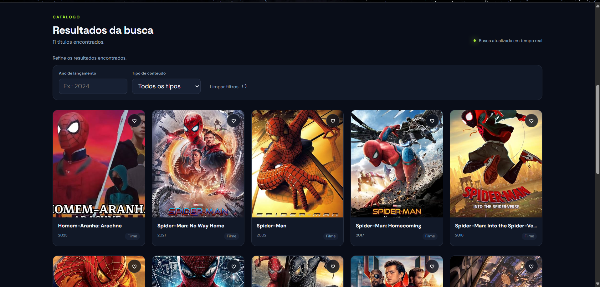
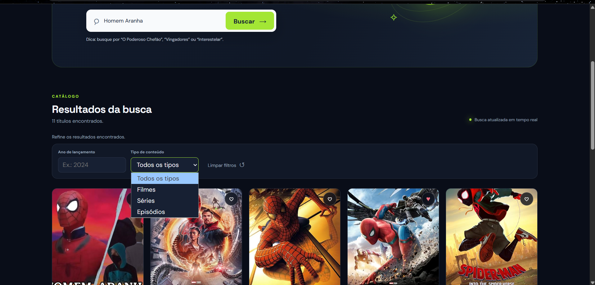
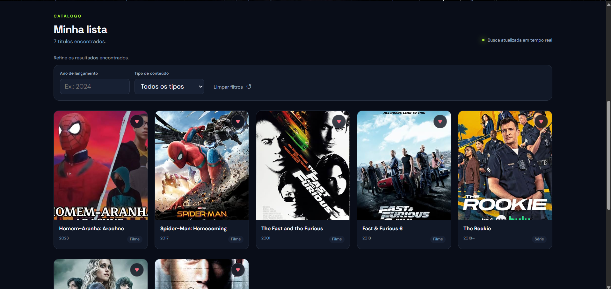

<div align="center">

# 🎬 TeleFilmes

### Descubra histórias incríveis. Monte sua própria lista.

Uma experiência moderna para explorar filmes e séries, pesquisar títulos e organizar seus favoritos.

   

[GitHub do desenvolvedor](https://github.com/DevElyShow) · [LinkedIn](https://www.linkedin.com/in/elydeivisoncesar/)

</div>

---

## 📖 Sobre o projeto

O **TeleFilmes** é uma aplicação front-end para descoberta de filmes e séries por meio de uma API externa. O projeto começou como um exercício de consumo de APIs, manipulação do DOM e organização modular em JavaScript e evoluiu para uma interface com pesquisa dinâmica, filtros, favoritos persistentes e alternância de temas.

O objetivo é proporcionar uma navegação simples e agradável, com foco em **responsividade, usabilidade e experiência do usuário**.

## ✨ Funcionalidades

| Recurso | Descrição |
| --- | --- |
| 🔎 **Busca em tempo real** | Atualização dos resultados conforme o usuário digita, com controle de requisições. |
| 🇧🇷 **Pesquisa por títulos em português** | Compatibilidade com títulos brasileiros conhecidos; cobertura ampliada mediante integração opcional com a TMDB. |
| 🎞️ **Catálogo de filmes e séries** | Cards com pôster, título, ano e tipo de conteúdo. |
| 📅 **Filtros contextuais** | Refinamento por ano e por tipo (filme, série ou episódio), disponível quando há resultados ou itens na lista. |
| ❤️ **Minha lista** | Adição e remoção de favoritos com armazenamento no `localStorage`. |
| 🌓 **Tema claro e escuro** | Alternância de aparência, com preferência persistida no navegador. |
| ℹ️ **Detalhes do título** | Visualização de informações adicionais sobre o conteúdo selecionado. |
| 📱 **Layout responsivo** | Interface adaptável a diferentes tamanhos de tela. |

## 🖼️ Galeria da interface

### Página inicial — tema escuro

O destaque inicial apresenta a proposta do TeleFilmes, campo de pesquisa e acesso rápido à lista pessoal.



### Página inicial — tema claro

O modo claro mantém a identidade visual da aplicação e o contraste do texto na área principal.



### Resultados da pesquisa

Os títulos encontrados são organizados em cards com pôsteres, ano de lançamento, tipo de conteúdo e botão de favorito.



### Filtros por ano e tipo

É possível refinar os resultados por ano de lançamento e selecionar filmes, séries ou episódios.



### Minha lista de favoritos

A seção **Minha lista** reúne os títulos salvos, que permanecem disponíveis após atualizar a página no mesmo navegador.



## 🛠️ Tecnologias utilizadas

- **HTML5:** estrutura semântica das páginas.
- **CSS3:** estilos, componentes, temas e responsividade.
- **JavaScript (Vanilla JS):** interatividade, manipulação do DOM, busca e gerenciamento de estado.
- **Fetch API:** comunicação com serviços externos.
- **LocalStorage:** persistência local de favoritos e preferência de tema.
- **OMDb API:** consulta de dados de filmes e séries.
- **TMDB API (opcional):** suporte mais abrangente à pesquisa por títulos localizados, mediante configuração de chave.

## 🚀 Como executar localmente

1. Clone o repositório:

   ```bash
   git clone https://github.com/DevElyShow/Tele-Filmes.git
   ```

2. Acesse a pasta do projeto:

   ```bash
   cd Tele-Filmes
   ```

3. Abra o projeto no **VS Code** e execute `index.html` usando a extensão **Live Server** (ou outro servidor HTTP local).

4. Confira a configuração das APIs no código antes de testar a pesquisa. Se necessário, configure sua própria chave de API conforme a implementação presente no projeto.

> **Nota sobre busca em português:** a OMDb não oferece pesquisa universal por títulos traduzidos. Sem a TMDB configurada, o suporte em português depende dos títulos mapeados no projeto; com a integração opcional, a cobertura pode ser ampliada. Não publique chaves privadas ou tokens sensíveis no repositório.

## 🧠 Aprendizados e evolução

O TeleFilmes permitiu praticar e aprofundar:

- Requisições assíncronas e consumo de APIs REST.
- Tratamento e apresentação de dados retornados por APIs.
- Manipulação do DOM e atualização dinâmica da interface.
- Armazenamento e recuperação de dados no navegador.
- Filtragem de resultados e experiência de pesquisa.
- Design responsivo, consistência visual e contraste entre temas.
- Organização e manutenção de um projeto front-end em evolução.

## 🔮 Próximos passos

- [ ] Expandir a pesquisa de títulos localizados sem depender de mapeamentos manuais.
- [ ] Melhorar a paginação e a exploração de grandes conjuntos de resultados.
- [ ] Adicionar recomendações e categorias de descoberta.
- [ ] Ampliar os testes de acessibilidade e comportamento em dispositivos móveis.

## 👨‍💻 Desenvolvedor

**Elydeivison Cesar**

[GitHub](https://github.com/DevElyShow) · [LinkedIn](https://www.linkedin.com/in/elydeivisoncesar/)

---

<div align="center"><strong>TeleFilmes — seu próximo play começa aqui. 🍿</strong></div>
